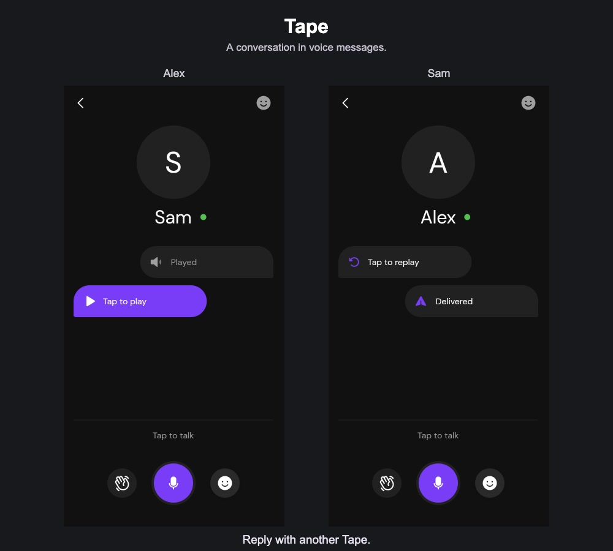

# Tape

Tape is a voice messaging app for Android and iOS. Record a message, send it to a friend, and listen to their reply.

## See it in action

[Watch the walkthrough (MP4)](docs/tape-walkthrough.mp4)

The video shows sign-in, choosing a name, finding a friend, sending and receiving voice messages, waves, sound emojis, and editing a profile.

## Using Tape

Sign in with your phone number and choose a display name. Open **New Tape** to find contacts who use Tape, then open a conversation.

Drag the microphone control to start recording. Slide it right to send the recording, or left to discard it. Your friend taps the incoming Tape to listen and can send a Tape back. The conversation shows when a Tape has been delivered or played.

You can also wave to get a friend's attention, react with a sound emoji, and change your name or profile photo.

## Built with

The mobile client is written in Flutter. Firebase provides phone sign-in, chat data, audio storage, and push notifications.
